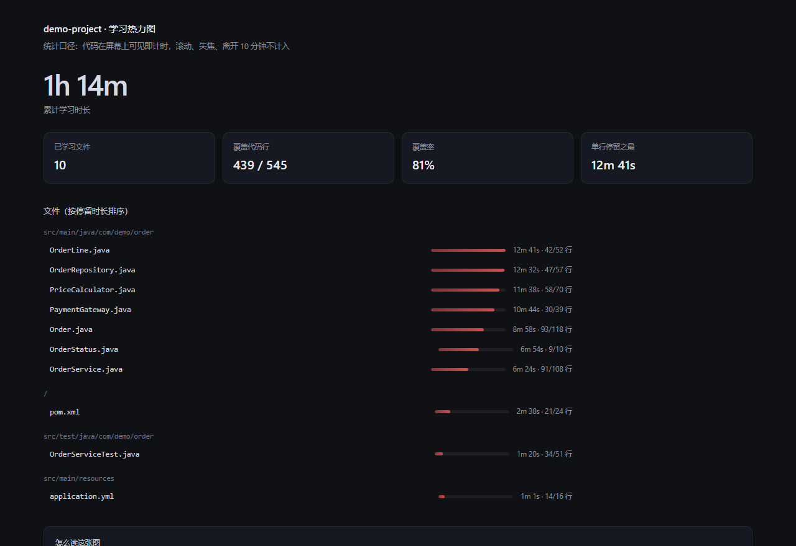
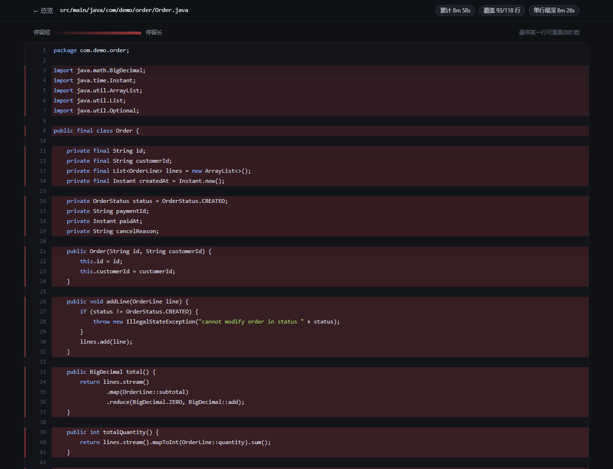

# Study Heatmap · 代码学习热力图

> 统计你在代码上真实停留了多久，退出项目时生成一份与源码目录 1:1 对应的染色副本。
>
> An IntelliJ IDEA plugin that tracks how long each line of code stayed on your screen, then renders it as a per-line heatmap.

[](https://github.com/lzh087/study-heatmap/actions/workflows/build.yml)
[](LICENSE)



## 它解决什么问题

「这个模块我到底看懂了没有？」——凭感觉往往不准。这个插件记录的是**真实的注意力分布**：哪些行在屏幕上停留了几分钟，哪些文件只是滚过去扫了一眼。

读完一个项目，你会得到一张按行染色的代码副本：颜色越深，说明那几行在你眼前待得越久。



## 特性

- **可见即计时**：屏幕上出现的每一行，每秒各记 1 秒
- **不算「假学习」**：滚轮滚动、窗口失焦、键鼠 10 分钟无操作都不计入
- **暂离会回退**：发现你早就走了，把「最后一次操作之后」记的时间倒扣回去
- **抗代码漂移**：按「行内容哈希」记账，改代码、切分支后热力仍能落回原来那几行
- **多次累计**：关项目时可选「保留，下次继续」，同一个项目跨天累加
- **两种产物**：可点击的 HTML 镜像 + 单文件 PDF

## 安装

### 方式一：下载构建好的插件

本仓库的 GitHub Actions 每次 push 都会构建插件：

`Actions → build → 最新一次运行 → Artifacts → study-heatmap-plugin`

也可以在本地构建（见下）。

### 方式二：从源码构建

需要 **JDK 21+**（IntelliJ Platform 2025.2 的要求）。仓库自带 Gradle wrapper，不用另装 Gradle。

```bash
git clone https://github.com/lzh087/study-heatmap.git
cd study-heatmap
./gradlew buildPlugin
```

产物：`build/distributions/study-heatmap-0.1.0.zip`

安装：`Settings → Plugins → ⚙ → Install Plugin from Disk`，选择该 zip，重启 IDE。

调试期更省事：`./gradlew runIde`，会拉起一个装好插件的沙箱 IDE。

插件只依赖 `com.intellij.modules.platform`，`since-build = 252`，即 **IDEA 2025.2 及以上**。

## 使用

1. 打开任意 Java 项目，右下角状态栏出现 `学习 03:24 · 本页 46s`
2. 正常读代码，计时在后台跑，每秒一拍
3. 关闭项目时弹窗选择：

   | 选择 | 行为 |
   |---|---|
   | 保留记录，下次继续累计 | 落盘，不生成报告，下次打开接着累加 |
   | 结算本次，并生成学习热力图 | 落盘 + 生成报告 + 用浏览器打开 |

4. 任何时候也可以点状态栏读数，或 `Tools → 生成学习热力图` 手动结算

## 输出物

报告写在 `<项目>/study-report/`：

```
study-report/
  index.html                                     总览：累计时长、覆盖率、文件排行
  src/main/java/com/demo/order/Order.java.html     ← 对应 Order.java，逐行背景染色
  learning-heatmap.pdf                            单文件 PDF：封面 + 清单 + 全部染色代码
  data.json                                       原始账本导出
```

- **HTML 镜像**：目录结构与源码 1:1，没学过的行保持原样，学过的行按停留时长叠加红色背景。颜色用对数缩放 —— 线性映射会让停留最久的那几行把整个色阶吃满，其余行看不出差别。
- **PDF**：由系统里的 Edge / Chrome 无头打印生成（`--headless=new --print-to-pdf`），排版与网页一致、中文不需要嵌字体、不用引 3MB 的 PDF 库。打印时会切到浅色主题，每个文件另起一页。找不到浏览器时只出 HTML，其它功能不受影响。
- 打开报告不依赖 Windows 文件关联：直接启动 `msedge.exe` / `chrome.exe` 并把路径作为参数传进去。有些机器 `.html` 关联表面正常、但 ShellExecute 报「找不到应用程序」，这样可以绕开。

## 统计口径

这些规则决定了数据是否可信：

1. **可见即计时**：每 1 秒一拍，当前屏幕上可见的**每一行**各加 1 秒（不是一屏共分 1 秒）。
2. **文件总时长**每拍也加 1 秒。所以「行时长之和」一定远大于「文件总时长」——前者是每行的驻留时长，后者是你在这个文件上花的时间。
3. **滚动不计**：滚轮事件后 800ms 内不计；同一文件内可见区首行发生变化的那一拍也不计。
4. **失焦不计**：IDE 窗口不在前台直接停表。
5. **暂离回退**：键鼠连续 10 分钟无操作视为离开，并把「最后一次操作之后」记下的时间全部抹掉。
   触控板滑动/双指滚动会以 `MOUSE_MOTION` / `MOUSE_WHEEL` 进入 AWT 事件队列，因此不会被误判成暂离。
6. **空白行不计**：留白没有阅读价值，统计进去只会形成没有意义的红块。
7. **按行内容记账**：账本主键是「行内容哈希 + 重复序号」，不是行号。
8. **不按会话清零**：多次打开同一项目持续累加，颜色深浅代表长期投入。

## 数据存放

账本不在项目里，避免污染仓库：

```
%USERPROFILE%\.study-tracker\projects\<项目名>-<路径哈希>\
  ledger.json     行级账本（文件 → 行锚点 → 秒数）
  sessions.jsonl  每次学习的起止与时长
  project.json    项目绝对路径
```

报告写在 `<项目>/study-report/`，建议加进目标项目的 `.gitignore`。想重置某个项目的统计，删掉对应目录即可。

## 项目结构

```
src/main/java/com/study/heatmap/
  core/          纯 Java，零 IDE 依赖：账本、回退日志、词法着色、HTML/PDF 渲染
  tracker/       IDE 侧：可见行采集、计时、空闲检测、落盘
  ui/            状态栏控件、退出选择弹窗、报告打开
  actions/       Tools 菜单动作
src/main/resources/META-INF/plugin.xml
tools/           开发期验证工具（不参与打包）
demo-project/    演示用的小型 Java 项目
```

设计上的两个关键点：

- **`core` 不依赖任何 IDE API**，因此可以在没有 IDEA 的环境里编译、单测、跑渲染，构建成本低。
- **`Journal` 回退日志**只保留最近 10 分钟的记录：更早的拍已经不可能被回退，没必要占内存。

## 本地自测（不需要 IDEA）

```bash
# 编译核心层 + 工具
find src/main/java/com/study/heatmap/core tools -name "*.java" > /tmp/sources.txt
javac --release 17 -encoding UTF-8 -d /tmp/core-classes @/tmp/sources.txt

# 回退逻辑单测（13 项断言）
java -cp /tmp/core-classes tools.JournalTest

# 用模拟账本跑真实渲染器，产出 demo-report/
java -cp /tmp/core-classes tools.CoreDemo demo-project demo-report
```

`JournalTest` 覆盖的是最容易写错的地方：一屏 50 行回退时，文件总时长只能减 1 秒，不能减 50 秒。

## 已知限制

- 只统计在 IDEA 里打开的文件。在浏览器、GitHub、PDF 上看代码不算。
- 分屏时只统计当前获得焦点的那个编辑器。
- 拖动滚动条、`PageDown` 翻页都会触发可见区变化，按「滚动不计」处理。
- 超过 2 MB 的文件，以及 `build/`、`target/`、`node_modules/`、`.git/` 等目录会自动跳过。
- 大重构之后，被改掉的行会变成「孤儿数据」：留在账本里但不再出现在报告中。这是内容锚定的必然代价，比整张图错位要好。
- 暂离阈值是常量 `StudyTrackerService.IDLE_MS`（10 分钟）。
- 同一页看久了，那一页所有行会同步变红 —— 这是「每行各 1 秒」口径的必然结果，不是 bug。

## 构建时遇到证书报错？

如果公司/学校网络对 HTTPS 做了 TLS 拦截，Gradle 会报
`unable to find valid certification path to requested target`。
此时要么把网关根证书导入 JDK 的 `cacerts`，要么把
`gradle/wrapper/gradle-wrapper.properties` 里的 `distributionUrl` 换成可达的镜像。

本仓库默认使用 `mirrors.cloud.tencent.com` 的 Gradle 发行版（`services.gradle.org` 会 302 跳到 GitHub，在网络受限时容易失败）。

## License

[MIT](LICENSE)
